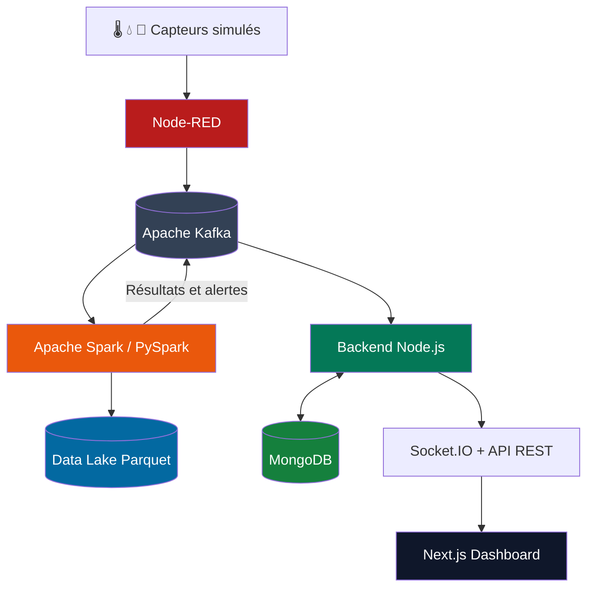

<p align="center">
  
</p>

<h1 align="center">🏙️ Smart City</h1>

<p align="center">
  <strong>Plateforme intelligente de supervision urbaine en temps réel</strong>
</p>

<p align="center">
  <em>IoT · Big Data · Stream Processing · Data Visualization</em>
</p>

<p align="center">
  Une architecture de données de bout en bout pour simuler,
  analyser et visualiser les dynamiques d'une ville intelligente.
</p>

<p align="center">
  
  
  
  
</p>

<p align="center">
  
  
  
  
  
</p>

<p align="center">
  
  
  
</p>

---

## 📖 À propos du projet

**Smart City** est une plateforme Big Data et IoT destinée à explorer la manière dont les technologies de traitement des données peuvent contribuer à la supervision d'une ville intelligente.

Le projet met en œuvre un pipeline de données capable de collecter des événements issus de capteurs simulés, de les transmettre à une infrastructure de streaming, de les traiter en continu et de présenter les résultats dans une application web interactive.

Inspirée notamment du contexte urbain d'**El Jadida, au Maroc**, la plateforme s'articule autour de trois domaines :

- 🌡️ **Environnement** — température et qualité de l'air.
- 💧 **Gestion de l'eau** — débit, consommation et qualité de l'eau.
- 🚦 **Mobilité urbaine** — trafic routier et détection de congestion.

L'objectif est de démontrer l'intégration de technologies modernes au sein d'une architecture orientée événements, depuis la génération des données jusqu'à leur exploitation visuelle.

> **Note :** le projet est un démonstrateur technique utilisant des données de capteurs simulées. Il ne prétend pas être connecté à une infrastructure municipale réelle.

---

## ✨ Fonctionnalités principales

### 🌐 1. Simulation de capteurs IoT

Des flux Node-RED simulent les observations de plusieurs catégories de capteurs urbains.

**Environnement**
- Température par capteur et par quartier.
- Indicateurs de qualité de l'air.
- Variations temporelles des mesures.

**Eau**
- Débit et consommation estimée.
- pH et turbidité.
- Surveillance des anomalies.

**Trafic**
- Vitesse moyenne des véhicules.
- Taux d'occupation de la route.
- Indice de congestion.
- Nombre de véhicules observés.

Les événements sont transmis à Apache Kafka pour alimenter le pipeline.

### ⚡ 2. Traitement des données en streaming

Apache Spark Structured Streaming assure le traitement des événements IoT.

Les traitements comprennent notamment :

- L'analyse des données reçues depuis Kafka.
- La validation et la structuration des événements.
- Les agrégations par quartier ou par route.
- Le calcul d'indicateurs sur des fenêtres temporelles.
- La gestion des événements reçus en retard.
- La détection d'anomalies selon des seuils configurables.
- La publication des résultats et alertes dans Kafka.

Les traitements reposent sur PySpark et conservent des checkpoints pour faciliter la reprise des flux.

### 🗃️ 3. Stockage et historique

La plateforme combine deux approches complémentaires.

**MongoDB**

Stockage des résultats agrégés et des alertes produits par Spark, permettant notamment leur consultation depuis l'API REST.

**Data Lake local**

Stockage de données au format Apache Parquet avec une organisation en deux niveaux :

- 🥉 **Bronze :** événements bruts provenant de Kafka.
- 🥈 **Silver :** données structurées et validées.

Les données du Data Lake sont organisées par domaine et partitionnées par date d'événement.

### 📡 4. Diffusion en temps réel

Le backend Node.js utilise Express, KafkaJS et Socket.IO pour :

- Consommer les événements Kafka.
- Diffuser les mesures brutes aux clients connectés.
- Enregistrer les agrégations et alertes Spark.
- Exposer les historiques et statistiques par API REST.
- Actualiser l'interface sans rechargement manuel.

### 📊 5. Dashboard interactif

L'interface Next.js propose plusieurs espaces de visualisation.

| Module | Fonctionnalités |
|---|---|
| 🏠 Vue d'ensemble | Synthèse des principaux indicateurs urbains |
| 🗺️ Carte interactive | Visualisation géographique des capteurs, quartiers et routes |
| 📈 Analyses | Graphiques et tendances des données |
| 🚨 Alertes | Consultation et filtrage des incidents détectés |
| ⚙️ Spark | Agrégations, alertes, erreurs et indicateurs de traitement |
| 🔧 Réglages | Consultation des services et paramètres affichés |

Le dashboard est construit avec React, TypeScript, Tailwind CSS, Leaflet et Recharts.

Les vues exploitent les données disponibles et affichent des états de chargement, de déconnexion ou d'absence de données lorsque nécessaire.

---

## 🏗️ Architecture technique

Le projet repose sur une architecture de streaming orientée événements.



### 🔄 Fonctionnement du pipeline

**Étape 1 — Génération**

Node-RED produit des mesures simulées relatives à l'environnement, à l'eau et au trafic.

**Étape 2 — Ingestion**

Les événements sont publiés dans des topics Apache Kafka dédiés à chaque domaine.

**Étape 3 — Traitement**

Spark Structured Streaming consomme les messages, effectue les calculs et applique les règles de détection.

**Étape 4 — Conservation**

Le Data Lake conserve les données brutes et validées ; MongoDB stocke les résultats agrégés et les alertes consommés par le backend.

**Étape 5 — Restitution**

Le backend expose les données par API REST et diffuse les mises à jour grâce à Socket.IO.

**Étape 6 — Visualisation**

Le dashboard Next.js présente les informations à travers des cartes, indicateurs et graphiques interactifs.

---

## 🛠️ Stack technologique

| Catégorie | Technologies | Utilisation |
|---|---|---|
| Frontend | Next.js 16, React 19 | Application web |
| Langage frontend | TypeScript | Développement typé |
| Interface | Tailwind CSS 4 | Styles et composants |
| Cartographie | Leaflet, React Leaflet | Visualisation géographique |
| Graphiques | Recharts | Analyses et statistiques |
| Backend | Node.js, Express 5 | API REST |
| Communication | Socket.IO | Événements temps réel |
| Simulation IoT | Node-RED | Génération des mesures |
| Streaming | Apache Kafka | Transport des événements |
| Traitement | Apache Spark 3.5.1, PySpark | Streaming et agrégations |
| Base de données | MongoDB, Mongoose | Historique agrégé |
| Data Lake | Apache Parquet | Stockage Bronze/Silver |
| Infrastructure | Docker, Docker Compose | Orchestration locale |

---

## 📂 Organisation du dépôt

| Répertoire ou fichier | Description |
|---|---|
| `backend/` | Serveur Express, API, modèles MongoDB et consumer Kafka |
| `frontend/` | Application Next.js et dashboard |
| `node-red/` | Simulation IoT, flux et scripts JavaScript |
| `spark/` | Traitements PySpark Structured Streaming |
| `spark/streams/` | Pipelines environnement, eau et trafic |
| `spark/utils/` | Fonctions partagées pour les flux Spark |
| `docker-compose.yml` | Définition et orchestration des services |
| `requirements.txt` | Dépendances Python |
| `LICENSE` | Licence Apache 2.0 |

Les dossiers de données et de checkpoints peuvent être créés lors de l'exécution.

---

## 📨 Topics Apache Kafka

Kafka constitue le système central de communication entre les composants.

### Topics d'ingestion

| Topic | Données |
|---|---|
| `smartcity.environment.readings` | Mesures environnementales |
| `smartcity.water.readings` | Mesures hydriques |
| `smartcity.traffic.readings` | Mesures de circulation |

### Topics de traitement

| Topic | Données |
|---|---|
| `smartcity.spark.environment` | Agrégations environnementales |
| `smartcity.spark.water` | Agrégations hydriques |
| `smartcity.spark.traffic` | Agrégations routières |
| `smartcity.spark.errors` | Erreurs de traitement des messages |
| `smartcity.spark.alerts` | Alertes détectées par Spark |

Les huit topics sont déclarés dans l'initialisation Kafka de Docker Compose.

Le topic environnemental d'entrée dispose de trois partitions ; les autres sont initialisés avec une partition dans la configuration actuelle.

---

## 🚀 Démarrage rapide

### Prérequis

Pour utiliser la plateforme avec Docker :

- Git.
- Docker.
- Docker Compose.
- Des ressources système suffisantes pour exécuter les différents services.

Pour un développement local, Node.js 20 et Python 3.11 sont les versions utilisées par les images applicatives du projet. Les traitements Spark locaux requièrent également un environnement Java et Spark compatible.

### 1. Cloner le dépôt

```bash
git clone https://github.com/ayyoubecharkaouy/smart-city.git
cd smart-city
```

### 2. Démarrer les services

Depuis la racine du dépôt :

```bash
docker compose up --build -d
```

Cette commande construit les images applicatives et lance les services définis dans Docker Compose.

La configuration prévoit notamment le démarrage de :

- ZooKeeper.
- Apache Kafka.
- Initialisation des topics Kafka.
- MongoDB.
- Node-RED.
- Backend Express.
- Frontend Next.js.
- Apache Spark.

> Le premier démarrage peut prendre plusieurs minutes, notamment pendant la construction des images et l'installation des dépendances.

### 3. Configurer les nœuds Kafka de Node-RED

Les flux du projet utilisent le module :

`node-red-contrib-kafkajs`

Lors du premier démarrage :

1. Ouvrez l'éditeur Node-RED.
2. Accédez à **Manage palette → Install**.
3. Installez `node-red-contrib-kafkajs` si ses nœuds sont absents.
4. Vérifiez la présence des flux. Si nécessaire, importez `node-red/flows.json`.
5. Déployez les flux pour commencer la simulation.

Dans Docker Compose, l'adresse Kafka configurée pour Node-RED est `kafka:29092`.

### 4. Vérifier les conteneurs

```bash
docker compose ps
```

Pour consulter les journaux :

```bash
docker compose logs -f
```

### 5. Accéder aux interfaces

| Service | Adresse |
|---|---|
| 🖥️ Dashboard | http://localhost:3000 |
| 🔌 API Backend | http://localhost:4000/api/health |
| ⚙️ Node-RED | http://localhost:1880 |

### 6. Vérifier l'API

```bash
curl http://localhost:4000/api/health
```

Le serveur doit répondre avec un statut `OK` et un horodatage.

Pour observer les traitements Spark :

```bash
docker compose logs -f spark
```

---

## 💻 Développement local

Il est également possible d'exécuter l'infrastructure dans Docker tout en développant les applications localement.

### 1. Démarrer l'infrastructure

```bash
docker compose up -d zookeeper kafka kafka-init mongodb
```

### 2. Lancer le backend

Dans un premier terminal :

```bash
cd backend
npm ci
node server.js
```

Le backend utilise par défaut le port `4000`.

### 3. Lancer le frontend

Dans un second terminal :

```bash
cd frontend
npm ci
npm run dev
```

L'interface est accessible sur :

http://localhost:3000

### 4. Lancer Node-RED

Dans un troisième terminal :

```bash
npm install -g node-red
node-red
```

Installez le module KafkaJS nécessaire, importez les flux du projet si besoin et vérifiez que les clients Kafka utilisent `localhost:9092`.

### 5. Lancer les traitements Spark

Installez les dépendances :

```bash
cd spark
python -m pip install -r requirements.txt
```

Sous Linux ou macOS :

```bash
./run_spark.sh
```

Sous Windows, les scripts suivants sont disponibles :

```text
run_spark.ps1
run_spark.cmd
```

Consultez [spark/README.md](spark/README.md) pour les instructions détaillées et les prérequis spécifiques à Windows.

---

## 🌐 API REST

Le backend expose plusieurs endpoints de consultation des données.

### État du service

```http
GET /api/health
```

### Environnement

```http
GET /api/temperatures/latest
GET /api/temperatures/avg-by-district
GET /api/temperatures/history
```

### Eau

```http
GET /api/water/latest
GET /api/water/stats-by-district
GET /api/water/history
```

### Trafic

```http
GET /api/traffic/latest
GET /api/traffic/stats-by-route
GET /api/traffic/history
```

### Apache Spark

```http
GET /api/spark/aggregations
GET /api/spark/alerts
```

Les routes Spark acceptent notamment les paramètres `type` et `limit`.

Exemple :

```bash
curl "http://localhost:4000/api/spark/aggregations?type=water&limit=20"
```

Les types reconnus sont :

- `environment`
- `water`
- `traffic`

Le code des endpoints est disponible dans [backend/routes/api.js](backend/routes/api.js).

---

## 🚨 Détection des anomalies

Spark applique des règles de détection sur les mesures entrantes.

Quelques exemples de seuils configurés :

| Indicateur | Condition |
|---|---|
| Qualité de l'air | AQI supérieur à 150 |
| Congestion | Indice supérieur à 0,75 |
| pH de l'eau | Inférieur à 6,5 ou supérieur à 8,5 |
| Turbidité | Supérieure à 5 |
| Chute du débit | Variation supérieure au seuil configuré |
| Tendance thermique | Variation supérieure au seuil configuré |

Ces règles peuvent être ajustées avec les paramètres de `spark/config.py`.

Les alertes sont publiées dans :

```text
smartcity.spark.alerts
```

Le backend peut ensuite les conserver et les diffuser vers le dashboard.

---

## 🥉🥈 Data Lake

La plateforme utilise un Data Lake local pour conserver les données à différentes étapes du pipeline.

### Couche Bronze

Les événements Kafka bruts sont conservés avec leurs informations techniques, notamment :

- Topic.
- Partition.
- Offset.
- Message JSON original.

### Couche Silver

Les événements validés et structurés sont enregistrés au format Parquet.

### Organisation

```text
data_lake/
├── bronze/
│   ├── environment/
│   ├── water/
│   └── traffic/
└── silver/
    ├── environment/
    ├── water/
    └── traffic/
```

Les fichiers sont partitionnés selon `event_date`.

La fonctionnalité peut être contrôlée avec :

```bash
DATA_LAKE_ENABLED=true
```

Le répertoire de stockage peut être personnalisé à l'aide de `DATA_LAKE_BASE_DIR`.

---

## ⚙️ Configuration

Les principaux paramètres Spark figurent dans :

`spark/config.py`

### Streaming

| Variable | Valeur par défaut |
|---|---|
| `WINDOW_DURATION` | `2 minutes` |
| `SLIDING_INTERVAL` | `1 minute` |
| `WATERMARK_DELAY` | `5 minutes` |
| `SPARK_CHECKPOINT_VERSION` | `v3` |
| `DATA_LAKE_ENABLED` | `true` |

Les valeurs peuvent être adaptées à l'environnement d'exécution.

Les modifications importantes de schéma ou de traitement Spark peuvent nécessiter une nouvelle version des checkpoints.

---

## 🔍 Diagnostic

### Les services ne démarrent pas

Vérifiez leur état :

```bash
docker compose ps
```

Consultez les journaux du service concerné :

```bash
docker compose logs --tail=100 kafka
docker compose logs --tail=100 backend
docker compose logs --tail=100 spark
```

### Aucune donnée n'apparaît dans le dashboard

Vérifiez :

1. Que Node-RED dispose des nœuds KafkaJS nécessaires.
2. Que les flux de simulation sont déployés.
3. Que Kafka est accessible.
4. Que les consumers du backend et de Spark fonctionnent.
5. Que l'API répond correctement.

### Le Data Lake ou les checkpoints sont inaccessibles

Vérifiez les droits d'écriture des répertoires montés dans les conteneurs.

Évitez d'attribuer systématiquement toutes les permissions à tous les utilisateurs.

### Les données Spark n'apparaissent pas

Consultez les journaux Spark et vérifiez la création des topics Kafka.

Une absence de données peut également provenir de l'absence d'événements de simulation.

---

## 🧹 Arrêter la plateforme

Pour arrêter les conteneurs tout en conservant les volumes persistants :

```bash
docker compose down
```

Pour supprimer également les volumes gérés par Docker Compose :

```bash
docker compose down -v
```

**Attention :** la seconde commande supprime notamment le volume MongoDB géré par Compose. Elle doit être réservée aux réinitialisations volontaires.

---

## 📌 État et périmètre du projet

Smart City est un projet technique de démonstration et d'expérimentation.

### Fonctionnalités présentes dans le code

- ✅ Simulation de données IoT.
- ✅ Pipeline Apache Kafka.
- ✅ Traitements Spark Structured Streaming.
- ✅ Détection d'anomalies.
- ✅ Stockage MongoDB des agrégations et alertes.
- ✅ Data Lake Parquet Bronze/Silver.
- ✅ API REST et événements Socket.IO.
- ✅ Dashboard Next.js.
- ✅ Cartographie interactive.
- ✅ Visualisation analytique.

### Extensions possibles

- 🔮 Intégration de capteurs IoT physiques.
- 🔮 Authentification et gestion des rôles.
- 🔮 Couverture de nouveaux domaines urbains.
- 🔮 Modèles prédictifs de Machine Learning.
- 🔮 Tests automatisés et intégration continue.
- 🔮 Renforcement de la sécurité et de l'observabilité.

Certaines catégories, comme l'énergie, l'éclairage public et les déchets, sont déjà représentées dans les sélecteurs de l'interface. Leur prise en charge complète nécessite des sources de données et des traitements supplémentaires.

---

## 📚 Documentation complémentaire

- [Documentation Backend](backend/README.md)
- [Documentation Node-RED](node-red/README.md)
- [Documentation Spark](spark/README.md)
- [Configuration Docker Compose](docker-compose.yml)

---

## 👨‍💻 Équipe

Projet réalisé par :

- **Echarkaouy Ayyoub**
- **Ghazi Zakaria**
- **Ahouir Mohamed**

---

## 📄 Licence

Ce projet est distribué sous licence **Apache License 2.0**.

Consultez le fichier [LICENSE](LICENSE) pour connaître les conditions d'utilisation, de modification et de redistribution.

---

<p align="center">
  <strong>🏙️ Smart City — Turning Urban Data into Actionable Insights</strong>
</p>

<p align="center">
  <em>From IoT simulation to real-time urban intelligence.</em>
</p>
