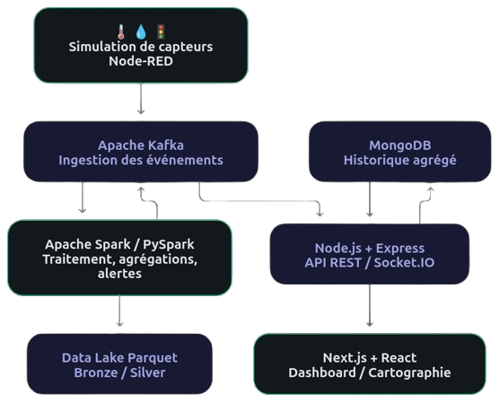
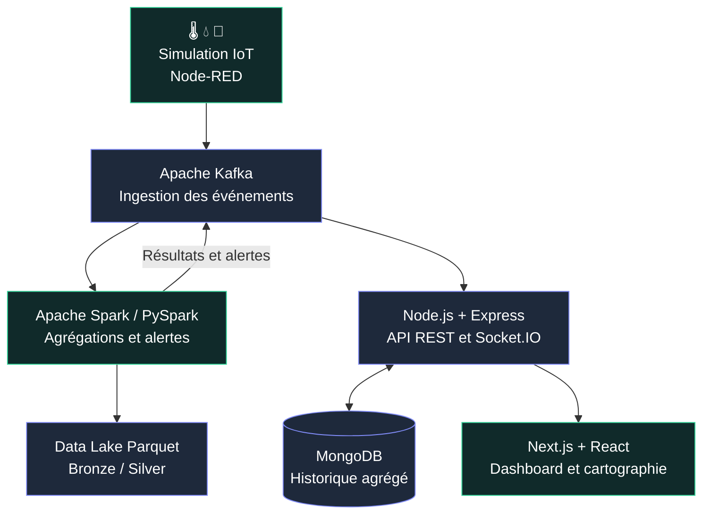

<p align="center">
  
</p>

<h1 align="center">🏙️ SMART CITY</h1>

<p align="center">
  <strong>Plateforme Big Data & IoT de supervision urbaine en temps réel</strong>
</p>

<p align="center">
  <em>Transformer les événements urbains en informations exploitables.</em>
</p>

<p align="center">
  
  
  
  
</p>

<p align="center">
  
  
  
  
  
</p>

<p align="center">
  <a href="LICENSE">
    
  </a>
  
  
</p>

<p align="center">
  <a href="#présentation">Présentation</a> ·
  <a href="#fonctionnalités">Fonctionnalités</a> ·
  <a href="#architecture">Architecture</a> ·
  <a href="#démarrage-rapide">Démarrage</a> ·
  <a href="#api-rest">API</a> ·
  <a href="#équipe">Équipe</a>
</p>

---

## Présentation

**Smart City** est une plateforme de supervision urbaine qui associe l'Internet des objets (IoT), le traitement distribué et la visualisation de données.

Elle illustre un pipeline complet de Data Engineering : des capteurs simulés produisent des événements, Apache Kafka les transporte, Apache Spark les analyse, puis une application web restitue les indicateurs et alertes.

Le projet prend notamment **El Jadida, au Maroc**, comme contexte géographique pour ses quartiers et infrastructures.

### 🎯 Objectifs

- **Collecter** des événements provenant de différentes catégories de capteurs urbains.
- **Traiter** les données en continu avec une architecture distribuée.
- **Détecter** les anomalies environnementales, hydriques et routières.
- **Conserver** les données brutes, validées et agrégées.
- **Visualiser** les indicateurs sur une carte et des tableaux de bord interactifs.
- **Démontrer** l'intégration de plusieurs technologies Big Data dans un même système.

> 💡 **Périmètre :** le projet utilise des capteurs simulés et constitue un démonstrateur technique. Les indicateurs ne doivent pas être interprétés comme des mesures officielles de la ville.

---

## Fonctionnalités

### 🌡️ Environnement

| Indicateur | Exploitation |
|---|---|
| Température | Mesures par capteur et moyennes par quartier |
| Qualité de l'air | Calcul et suivi d'indicateurs AQI |
| Historique | Évolution temporelle des valeurs |
| Alertes | Détection des dépassements de seuils |

### 💧 Gestion intelligente de l'eau

| Indicateur | Exploitation |
|---|---|
| Débit | Mesures et agrégations par quartier |
| Qualité | Suivi du pH et de la turbidité |
| Consommation | Indicateurs dérivés des données de débit |
| Anomalies | Détection de valeurs anormales |

### 🚦 Mobilité et trafic

| Indicateur | Exploitation |
|---|---|
| Vitesse moyenne | Suivi de la circulation |
| Congestion | Analyse des indices de congestion |
| Occupation | Observation de l'occupation routière |
| Véhicules | Comptages issus de la simulation |
| Alertes | Détection des congestions importantes |

### 📊 Interface de supervision

L'application Next.js propose plusieurs espaces complémentaires :

| Vue | Description |
|---|---|
| 🏠 Vue d'ensemble | Indicateurs globaux de la ville |
| 🗺️ Carte | Quartiers, routes et capteurs géolocalisés |
| 📈 Analyses | Graphiques, filtres et tendances |
| 🚨 Alertes | Centre de consultation des incidents |
| ⚙️ Spark | Agrégations, erreurs et résultats du streaming |
| 🔧 Réglages | Consultation des services et seuils affichés |

Les mises à jour sont diffusées au moyen de Socket.IO. L'interface prévoit des états spécifiques lorsque les services sont indisponibles ou que les données sont absentes.

---

## Architecture

L'architecture repose sur la circulation d'événements entre des composants spécialisés.

<p align="center">
  
</p>

<p align="center">
  <em>Figure 1 — Architecture de traitement et de visualisation des données Smart City.</em>
</p>

<details>
<summary><strong>🧩 Afficher le diagramme Mermaid éditable</strong></summary>



</details>

### 🔄 Parcours d'un événement

1. **Simulation :** Node-RED génère une mesure environnementale, hydrique ou routière.
2. **Ingestion :** la mesure est envoyée vers un topic Kafka.
3. **Analyse :** Spark valide les événements, calcule des agrégations et détecte les anomalies.
4. **Publication :** Spark renvoie ses résultats et alertes vers des topics Kafka.
5. **Persistance :** le Data Lake conserve les événements au format Parquet ; le backend stocke les agrégations et alertes dans MongoDB.
6. **Diffusion :** Express expose les données par API REST et Socket.IO transmet les événements en direct.
7. **Visualisation :** Next.js affiche les statistiques, cartes et alertes.

---

## Stack technologique

| Couche | Technologies | Rôle |
|---|---|---|
| IoT | Node-RED, JavaScript | Simulation des capteurs |
| Messaging | Apache Kafka, KafkaJS, ZooKeeper | Communication événementielle |
| Processing | Apache Spark, PySpark | Streaming et agrégations |
| Data Lake | Apache Parquet | Données Bronze et Silver |
| Database | MongoDB, Mongoose | Historique agrégé et alertes |
| Backend | Node.js 20, Express 5 | API REST |
| Real-time | Socket.IO | Diffusion aux clients |
| Frontend | Next.js 16, React 19 | Application web |
| Styling | Tailwind CSS 4 | Interface responsive |
| Maps | Leaflet, React Leaflet | Cartographie |
| Charts | Recharts | Visualisations analytiques |
| Infrastructure | Docker, Docker Compose | Exécution des services |

---

## Démarrage rapide

### 🛠️ Prérequis

- Git
- Docker
- Docker Compose
- Des ressources suffisantes pour les services Kafka, Spark, MongoDB et les applications

### 1. Cloner le projet

```bash
git clone https://github.com/ayyoubecharkaouy/smart-city.git
cd smart-city
```

### 2. Démarrer les conteneurs

```bash
docker compose up --build -d
```

Docker Compose prépare l'infrastructure, les services applicatifs et l'initialisation des topics Kafka.

Le premier démarrage peut nécessiter plusieurs minutes.

### 3. Finaliser la configuration Node-RED

Les flux utilisent le paquet `node-red-contrib-kafkajs`.

Depuis l'interface Node-RED :

1. Ouvrir **Manage palette → Install**.
2. Installer `node-red-contrib-kafkajs` si les nœuds sont absents.
3. Vérifier les flux existants ou importer `node-red/flows.json`.
4. Déployer les flux.
5. Vérifier l'émission des événements.

Le broker utilisé dans Docker Compose est `kafka:29092`.

### 4. Vérifier les services

```bash
docker compose ps
```

### 5. Accéder aux interfaces

| Interface | Adresse |
|---|---|
| 🖥️ Dashboard | http://localhost:3000 |
| 🔌 API Health | http://localhost:4000/api/health |
| ⚙️ Node-RED | http://localhost:1880 |

### 6. Vérifier les traitements

```bash
curl http://localhost:4000/api/health
```

```bash
docker compose logs -f spark
```

L'apparition de données dépend du bon fonctionnement des flux Node-RED, des topics Kafka et des traitements Spark.

---

## Développement local

Une approche hybride permet de conserver Kafka et MongoDB dans Docker tout en exécutant le code applicatif localement.

### Infrastructure

```bash
docker compose up -d zookeeper kafka kafka-init mongodb
```

### Backend

```bash
cd backend
npm ci
node server.js
```

### Frontend

```bash
cd frontend
npm ci
npm run dev
```

### Node-RED

```bash
npm install -g node-red
node-red
```

Installer ensuite le module KafkaJS et importer les flux si nécessaire. Pour une exécution locale, vérifier l'adresse `localhost:9092`.

### Spark

Depuis le répertoire `spark/` :

```bash
python -m pip install -r requirements.txt
./run_spark.sh
```

Sous Windows, utiliser les scripts `run_spark.ps1` ou `run_spark.cmd`.

📘 [Consulter la documentation Spark](spark/README.md)

---

## Flux Kafka

### 📥 Topics entrants

| Topic | Contenu |
|---|---|
| `smartcity.environment.readings` | Environnement |
| `smartcity.water.readings` | Eau |
| `smartcity.traffic.readings` | Trafic |

### 📤 Topics produits par Spark

| Topic | Contenu |
|---|---|
| `smartcity.spark.environment` | Agrégations environnementales |
| `smartcity.spark.water` | Agrégations hydriques |
| `smartcity.spark.traffic` | Agrégations du trafic |
| `smartcity.spark.errors` | Messages invalides |
| `smartcity.spark.alerts` | Alertes de traitement |

Les topics sont initialisés automatiquement par le service `kafka-init`.

---

## Stockage des données

### 🥉 Bronze — événements bruts

Les messages Kafka originaux sont conservés dans des fichiers Parquet avec des métadonnées de provenance.

### 🥈 Silver — événements validés

Les événements sont structurés et préparés pour des analyses ultérieures.

### 🍃 MongoDB — résultats agrégés

Le backend conserve notamment les agrégations et les alertes Spark afin de servir les vues historiques.

La structure locale du Data Lake est la suivante :

```text
data_lake/
├── bronze/
│   ├── environment/
│   ├── water/
│   └── traffic/
└── silver/
    ├── environment/
    ├── water/
    └── traffic/
```

---

## API REST

L'API est disponible par défaut sur :

`http://localhost:4000/api`

| Méthode | Endpoint | Description |
|---|---|---|
| GET | `/health` | Santé du backend |
| GET | `/temperatures/latest` | Dernières mesures environnementales |
| GET | `/temperatures/avg-by-district` | Statistiques par quartier |
| GET | `/temperatures/history` | Historique environnemental |
| GET | `/water/latest` | Dernières mesures d'eau |
| GET | `/water/stats-by-district` | Statistiques hydriques |
| GET | `/water/history` | Historique hydrique |
| GET | `/traffic/latest` | Dernières observations du trafic |
| GET | `/traffic/stats-by-route` | Statistiques par route |
| GET | `/traffic/history` | Historique du trafic |
| GET | `/spark/aggregations` | Agrégations Spark |
| GET | `/spark/alerts` | Alertes Spark |

Exemple :

```bash
curl "http://localhost:4000/api/spark/aggregations?type=water&limit=20"
```

Les types disponibles sont `environment`, `water` et `traffic`.

📘 [Code des routes API](backend/routes/api.js)

---

## Détection d'anomalies

Spark analyse certaines mesures selon des seuils configurables.

| Domaine | Règle | Seuil par défaut |
|---|---|---|
| 🌫️ Air | AQI élevé | Supérieur à 150 |
| 🚦 Trafic | Congestion importante | Supérieur à 0,75 |
| 💧 Eau | pH anormal | Hors de 6,5 à 8,5 |
| 💧 Eau | Turbidité excessive | Supérieure à 5 |
| 💧 Eau | Chute de débit | Supérieure à 10 |
| 🌡️ Environnement | Variation thermique | Supérieure à 1 |

Les paramètres figurent dans [spark/config.py](spark/config.py).

Les alertes générées sont publiées dans `smartcity.spark.alerts`.

---

## Configuration Spark

| Variable | Valeur par défaut | Description |
|---|---|---|
| `WINDOW_DURATION` | `2 minutes` | Taille des fenêtres |
| `SLIDING_INTERVAL` | `1 minute` | Intervalle de glissement |
| `WATERMARK_DELAY` | `5 minutes` | Tolérance aux événements tardifs |
| `SPARK_CHECKPOINT_VERSION` | `v3` | Version des checkpoints |
| `DATA_LAKE_ENABLED` | `true` | Activation du Data Lake |

Ces paramètres peuvent être modifiés à travers les variables d'environnement prises en charge par le projet.

---

## Diagnostic

<details>
<summary><strong>Les conteneurs ne démarrent pas</strong></summary>

```bash
docker compose ps
docker compose logs --tail=100 kafka
docker compose logs --tail=100 backend
docker compose logs --tail=100 spark
```

Vérifier les dépendances, les ports utilisés et les ressources disponibles.

</details>

<details>
<summary><strong>Le dashboard n'affiche aucune donnée</strong></summary>

Vérifier successivement :

1. Le déploiement des flux Node-RED.
2. L'installation du module KafkaJS.
3. La connexion au broker Kafka.
4. L'exécution des traitements Spark.
5. La connexion du backend.
6. La disponibilité de Socket.IO.

</details>

<details>
<summary><strong>Problèmes d'écriture dans le Data Lake</strong></summary>

Vérifier que les répertoires montés dans les conteneurs sont accessibles en écriture par les utilisateurs correspondants.

Éviter l'utilisation systématique de permissions `777`.

</details>

---

## Arrêter l'environnement

### Arrêt normal

```bash
docker compose down
```

Cette commande conserve les volumes persistants.

### Réinitialisation des volumes

```bash
docker compose down -v
```

> ⚠️ **Attention :** cette seconde commande supprime notamment les données du volume MongoDB géré par Docker Compose. Elle doit uniquement être utilisée lorsqu'une réinitialisation est souhaitée.

---

## État du projet et perspectives

### ✅ Capacités implémentées

- Simulation IoT avec Node-RED.
- Ingestion Kafka.
- Traitements Spark Structured Streaming.
- Agrégations temporelles.
- Détection d'anomalies.
- Stockage Parquet Bronze/Silver.
- Historique MongoDB.
- API REST.
- Diffusion Socket.IO.
- Dashboard interactif.
- Cartographie et graphiques analytiques.

### 🚀 Évolutions envisageables

- [ ] Connecter des capteurs IoT physiques.
- [ ] Ajouter des tests automatisés et une CI.
- [ ] Introduire une authentification et des rôles.
- [ ] Étendre les données à l'énergie, aux déchets et à l'éclairage.
- [ ] Développer des modèles prédictifs de Machine Learning.
- [ ] Ajouter davantage d'outils d'observabilité.
- [ ] Renforcer la sécurité pour un déploiement public.

Ces éléments constituent des pistes d'amélioration, et non des fonctionnalités annoncées comme opérationnelles.

---

## Documentation

| Composant | Documentation |
|---|---|
| 🔌 Backend | [backend/README.md](backend/README.md) |
| 🌐 Frontend | [frontend/README.md](frontend/README.md) |
| ⚙️ Node-RED | [node-red/README.md](node-red/README.md) |
| ⚡ Spark | [spark/README.md](spark/README.md) |
| 🐳 Docker | [docker-compose.yml](docker-compose.yml) |

---

## Équipe

Projet développé par :

- **ECHARKAOUY Ayyoub**
- **GHAZI Zakaria**
- **AHOUIR Mohamed**

---

## Licence

Le projet est distribué sous licence **Apache 2.0**.

Voir le fichier [LICENSE](LICENSE) pour les conditions applicables.

---

<p align="center">
  <strong>🏙️ SMART CITY</strong>
</p>

<p align="center">
  <em>From IoT Simulation to Real-Time Urban Intelligence.</em>
</p>

<p align="center">
  <a href="#top">Retour en haut ↑</a>
</p>
